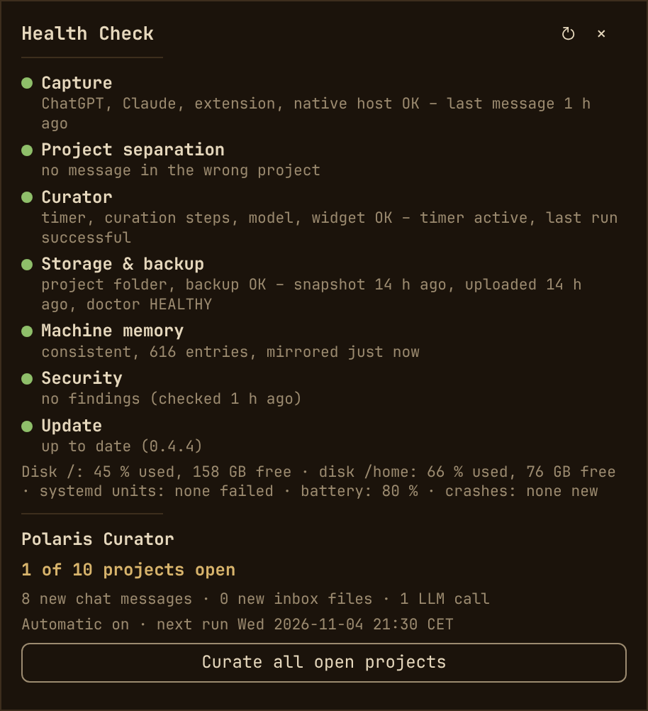
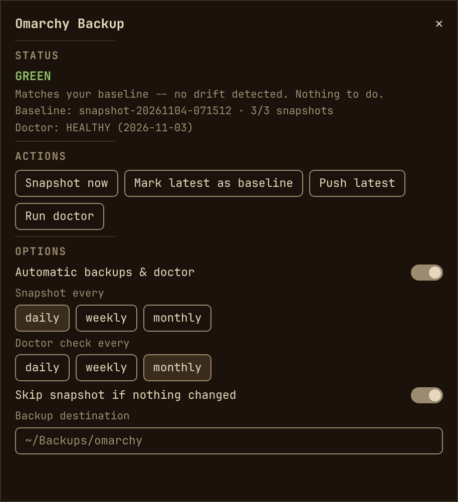

<div align="center">

# Polaris

### *Your AI project memory for [Omarchy](https://omarchy.org)*

Chats, meetings, mails and documents in. A sourced memory per project out.

<p>
  <a href="#install"><b>Install</b></a> •
  <a href="#whats-included"><b>What's included</b></a> •
  <a href="#documentation"><b>Docs</b></a> •
  <a href="#architecture-core-and-modules"><b>Architecture</b></a> •
  <a href="#privacy-and-legal-notice"><b>Privacy</b></a>
</p>

</div>

You work on projects with ChatGPT and Claude, and the decisions, facts and
open questions end up scattered across dozens of chats, documents and mails.
Polaris collects them per project while you work and has the coding agent you
already use write a short, sourced memory for each project: **what is known,
what was decided, what is still open.** It lives as plain Markdown in your own
project folders, readable by you, your editor and every AI agent on your
machine.


<sub>Illustration based on a demo project (invented content, translated). The
curator currently writes its field labels in German („Fakt“, „Konfidenz“);
the real file is shown [further below](docs/core.md#curator).</sub>

No account, no cloud service, no database. The only thing that leaves your
computer is what the curator hands to your own agent CLI (Codex, Claude Code,
or any command, local models included). Every entry links back to the chat
message or file it came from.

In daily use with **ChatGPT and Claude**, whose project chats are captured
automatically. Any other assistant that organises work in projects (Gemini,
Grok, Perplexity, …) can feed Polaris today through the inbox, as exported
or pasted chats and documents. Automatic capture for another assistant means
one more extension module plus its mapping in the bridge; contributions are
welcome (see [CONTRIBUTING.md](CONTRIBUTING.md)).

## Install

**1. Get it and run the guided setup** (asks a few questions, shows a summary,
then sets up):

```bash
git clone https://github.com/mstio/polaris-connector ~/Projects/polaris-connector
~/Projects/polaris-connector/install.sh
```

**2. Add the browser extension** (optional, for automatic chat capture):
install the signed Firefox extension from the
[latest release](https://github.com/mstio/polaris-connector/releases/latest)
and switch sync on in a ChatGPT or Claude project.

**3. Work as usual.** Chats are captured, the curator updates each project's
memory at night or at a click in the bar. `polaris update` keeps everything
current.

Details, options and updating: [docs/install.md](docs/install.md).

## What you get

- **Chats archived as you go.** A Firefox extension saves finished turns of
  ChatGPT and Claude *project* chats into the matching project folder. No
  copy and paste, nothing from chats outside a project. Other assistants:
  via the inbox for now.
- **Documents and mails, too.** Drop files or `.eml` mails (with attachments,
  Word, Excel, PowerPoint) into a project's `inbox/`.
- **A memory per project.** `knowledge.md`, `decisions.md` and
  `open-loops.md`: condensed, deduplicated, kept current, every entry with its
  source. Unclear cases wait for you; Polaris never guesses a project.
- **One glance in your bar.** A theme-aware Omarchy widget shows new material
  per project, starts curation, opens the knowledge files and tells you when
  something is broken: capture, curation, backup, disk, security.
- **Cheap in the background.** No polling daemons: systemd path units,
  timers and on-demand processes only.
- **More than memory:** health check, security radar, backups and a shared
  memory for your AI agents; see [What's included](#whats-included).

<p align="center">
  
  &nbsp;
  
</p>

<sub>Left: the Polaris widget with the health check (English UI, rendered from a
mock-up of the real panel).
Right: the omarchy-backup widget (mock-up with the real widget texts).</sub>

## What's included

Polaris is a small suite. At its heart is the project memory; around it are
tools that capture your material automatically and keep your Omarchy machine
and your AI setup healthy. Pick what you need.

**The project memory**

- **Polaris core:** never lose track of a project again. Each project gets
  three short files: what is known, what was decided, what is still open.
  Plain text in your own folders, so you can read, search, back up or hand
  them to any AI. [More](docs/core.md)
- **Curator:** you no longer write the summary yourself. Once a night (or at
  a click) your own AI assistant reads what is new and updates the three
  files: no duplicates, outdated facts replaced, and every entry says where
  it came from and how certain it is. [More](docs/core.md#curator)

**Getting material in**

- **Browser capture:** no copy and paste. Your ChatGPT and Claude project
  chats are saved to the right project folder while you work. Older chats
  can be imported from the official ChatGPT export. [More](docs/browser-capture.md)
- **Inbox:** everything else counts too. Drop documents, notes, meeting
  transcripts or mails (with attachments) into a project's inbox folder. [More](docs/inbox.md)

**Keeping an eye on things**

- **Curator widget:** your projects at a glance in the Omarchy bar: what is
  new, what is waiting, one click to update the memory or open the files. [More](docs/curator-widget.md)
- **Health check:** know it works without checking. One panel shows whether
  capture, curation, backups, security and updates are fine, and says
  plainly when something needs you. [More](docs/health-check.md)
- **Radar and security check:** hear about it before it bites. Daily, cheap
  check for security fixes that affect your machine, plus Omarchy news and
  plugin updates before you change your setup. [More](docs/radar.md)

**Protecting your setup**

- **Backup:** a broken update or a new laptop is no longer a lost weekend.
  [omarchy-backup](https://github.com/mstio/omarchy-backup) saves your
  working Omarchy setup, notices what changed since, checks that the copy in
  your cloud folder is really usable, and restores it on a fresh install. [More](docs/backup-and-extras.md)
- **Machine memory:** your AI agents stop forgetting. Claude Code, Codex and
  others share one notebook about your machine (what was set up, why, what
  to avoid), so you don't explain it again in every session. [More](docs/machine-memory.md)

**Extras**

- **Agent launcher and dock:** start Claude Code, Codex or Agy from the bar,
  and an app dock for Omarchy. [More](docs/backup-and-extras.md#extras-agent-launchers-and-dock)

Core and curator are always installed, everything else is optional; see
[Architecture](#architecture-core-and-modules) for how the parts fit together.

Current extension version: see `extension/manifest.json`. What changed between
versions: [`CHANGELOG.md`](CHANGELOG.md) (German). The module documents under
[`docs/`](#documentation) are in English; curator internals are in German.

## Privacy and legal notice

Polaris is a tool, not a compliance solution. You are responsible for using
it in line with the law that applies to you (in the EU: the GDPR) and with
your providers' terms. Please check before you use it, especially at work.

- **What it stores:** copies of your project chats, documents and mails, and
  curated summaries that can attribute statements to named people. All of
  it stays in your own folders; delete a project folder and it is gone.
- **What leaves your machine:** whatever the curator hands to the agent CLI
  you configure. That provider's terms and data processing apply (for
  example OpenAI for Codex, Anthropic for Claude Code). To keep everything
  local, use a local model via `runtime: command`.
- **Other people's data:** chats and mails often contain names, contact
  details and opinions of third parties. Purely personal use may fall under
  the household exemption; professional use usually does not. Then you
  typically need a legal basis, a data processing agreement with the model
  provider, information for the people concerned and deletion rules. Ask
  your data protection officer or legal adviser.
- **Provider terms:** the extension reads your own chats through the web
  apps' internal interfaces. Check that this is compatible with the terms of
  the services you use.

This notice is not legal advice. Polaris comes without warranty (MIT
licence).

## Architecture: core and modules

Polaris is a small **core** with **modules** around it. The core is the
project memory; everything else feeds it, shows it or keeps the machine
healthy.

| Part | What it is | Lives in |
|---|---|---|
| **Core: project memory** | Project folder layout, the curator that condenses sources into knowledge, the `polaris` / `polaris-curator` CLIs | `curator/`, `bridge/polaris/mapping.py`, `bridge/bin/polaris` |
| Source: browser capture | Firefox extension + native messaging host + bridge; archives ChatGPT and Claude project chats turn by turn into `raw/` | `extension/`, `bridge/` |
| Source: ChatGPT data export | Fills gaps from the official export, or files old chats as Markdown without curation | `polaris import-export`, `polaris archive-export` |
| Source: inbox | Documents, notes and mails dropped into `<project>/inbox/` | `curator/` (see `curator/README.md`) |
| Model runtimes | The curator calls an agent CLI: `codex`, `claude` or any command | `curator/curator.example-*.yaml` |
| Display: curator widget | Omarchy bar widget: pending sources, start runs, open knowledge files, health check | `omarchy-plugin/mst.polaris-curator/` |
| Cross-cutting: health check | One overview of capture, curation, backup, memory, security and system state | `curator/polaris_curator/systemhealth.py` |
| Cross-cutting: radar | Omarchy news, plugin updates and a daily security check (Arch tracker, kernel, CISA KEV, NVD) | `memory/tools/polaris-radar` |
| Cross-cutting: machine memory | Shared Markdown memory for all local AI agents, with linter, template and mirror | `memory/` |
| Cross-cutting: backup | [omarchy-backup](https://github.com/mstio/omarchy-backup): snapshots, baseline drift, verified remote backup, fresh-install recovery, plus [its bar widget](https://github.com/mstio/mst.omarchy-backup) | separate repos, fetched by `install.sh` via git |
| Extras | [Agent launcher widget](https://github.com/mstio/mst.agent-launchers) and [dock](https://github.com/thepathless/omadock) | separate repos, fetched by `install.sh` via git |
| Developer tooling | Privacy check with protected folders, template sync check, public mirror | `scripts/` |

```
 ChatGPT / Claude (Firefox)     official export      documents, mails
          |                          |                      |
   extension -> native host     polaris import-export       |
          |      -> bridge           |                      |
          v                          v                      v
   <project>/raw/<chatgpt|claude>/  ...................  <project>/inbox/
                         \                              /
                          `----> polaris-curator <-----'      model runtime
                                       |                  <-- (codex, claude,
                                       v                       any command)
              <project>/knowledge.md, decisions.md, open-loops.md
                                       |
          curator widget, health check, your agents, your editor
```

Direction of travel: the health check should only read one state file per
module (the radar already works that way with
`~/.local/state/polaris/security.json`), so that it can become a standalone
package and modules can be installed one by one. Today `install.sh` still
sets up all modules together and the health check knows each of them.

## Documentation

| Topic | Document |
|---|---|
| Install, options, updating, switching from the old bundle | [docs/install.md](docs/install.md) |
| Project folders, mapping, curator | [docs/core.md](docs/core.md) |
| Browser capture (extension, bridge, troubleshooting) | [docs/browser-capture.md](docs/browser-capture.md) |
| ChatGPT data export | [docs/chatgpt-export.md](docs/chatgpt-export.md) |
| Inbox (documents and mail) | [docs/inbox.md](docs/inbox.md) |
| Model runtimes | [docs/model-runtimes.md](docs/model-runtimes.md) |
| Curator widget | [docs/curator-widget.md](docs/curator-widget.md) |
| Health check | [docs/health-check.md](docs/health-check.md) |
| Radar and security check | [docs/radar.md](docs/radar.md) |
| Machine memory | [docs/machine-memory.md](docs/machine-memory.md) |
| Backup and extras | [docs/backup-and-extras.md](docs/backup-and-extras.md) |
| Developer tooling (privacy check, mirror) | [docs/developer-tooling.md](docs/developer-tooling.md) |
| Paths, uninstalling, tests | [docs/reference.md](docs/reference.md) |
| Curator internals (German) | [curator/README.md](curator/README.md) |
| Contributing | [CONTRIBUTING.md](CONTRIBUTING.md) |
| Changes (German) | [CHANGELOG.md](CHANGELOG.md) |

## License

MIT, see [`LICENSE`](LICENSE).
