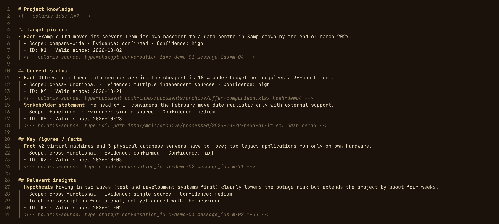

# Core: project memory

## Project folders

Polaris works on ordinary folders below one or more **project roots**. Each
project folder gets:

```
<project>/
  raw/chatgpt/messages/<message-id>.json         archived turns (browser capture, export)
  raw/chatgpt/conversations/<conversation-id>.json
  raw/claude/...                                 the same for Claude
  inbox/{documents,notes,mail}/                  drop documents and mails here
  knowledge.md  decisions.md  open-loops.md      curated knowledge
  dokumente-index.md                             index of processed documents
  .polaris/                                      curator state, journal, backups
```

Raw data is append-only and never summarised; the curated files are written
by the curator and stay readable and editable.

```bash
polaris roots                     # roots with number of project folders
polaris roots add <folder>        # folder that contains the project folders
polaris roots remove <folder>     # refused while mappings point into it (--force)
```

On first start only `~/Projekte` is added automatically, if it exists. A root
does not have to be a cloud drive; any local or mounted folder works. Keep
code and program state outside the project roots so that no git repository or
bridge state ends up in a cloud sync. The health check (line "project
folders") checks every root: a missing root or missing mapped project folders
(typically a dropped mount) is an error; for rclone mounts it also watches the
upload backlog.

## Project mapping

Chat projects are mapped to project folders automatically, in this order:
known mapping → exact name → normalised name (case, `_`/`-`, numbering
prefixes) → fuzzy match only when it is unambiguous. When unsure, the
messages wait as **pending**; Polaris never guesses.

```bash
polaris projects                          # known mappings
polaris pending                           # unknown projects with candidates (informational only)
polaris map <project-id> <local-path>     # also re-processes waiting messages of that project
polaris unmap <project-id>
polaris status                            # inbox size, events, projects, conversations, last run
```

The target must be inside a configured project root; anything else is refused
(protection against wrong assignments and path traversal).

## Curator

`polaris-curator` reads new raw turns and inbox documents per project, asks
the configured model runtime for changes and merges them atomically into
`knowledge.md`, `decisions.md` and `open-loops.md`, with a source reference
for every entry. A systemd timer runs it; the widget can start it by hand.
Classification rules, budgets, journal, compaction, retraction and document
handling are described in [`curator/README.md`](../curator/README.md) (German).



<sub>The demo project's `knowledge.md` in an editor (invented content, English
labels; rendered from a mock-up of the real file).</sub>

---

[Back to the README](../README.md)
