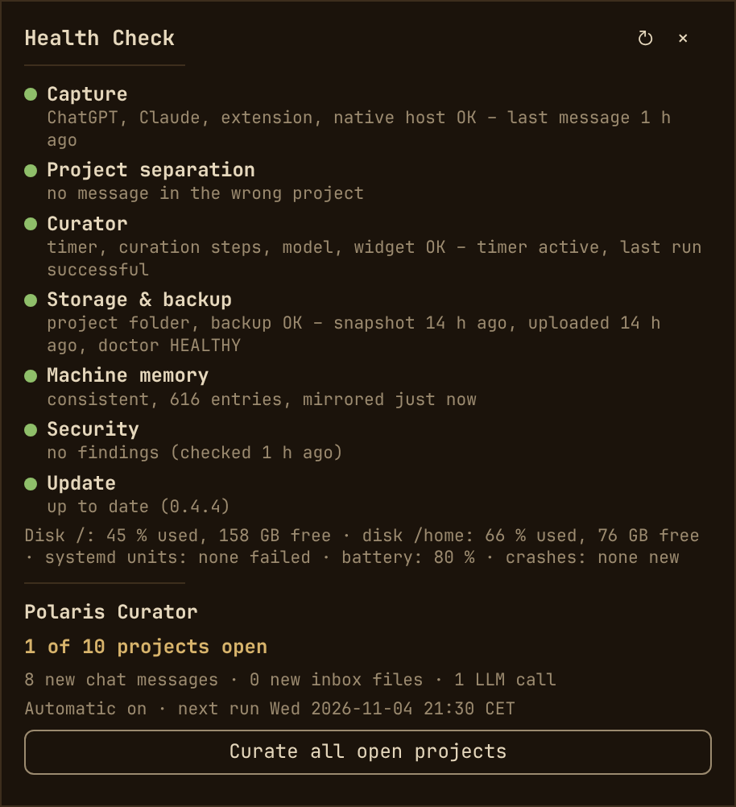

# Polaris – Omarchy bar widget



The bar widget for [Polaris](https://github.com/mstio/polaris-connector), a
project memory for [Omarchy](https://omarchy.org): your ChatGPT and Claude
project chats, meeting transcripts, mails and documents become three short,
sourced files per project – what is known, what was decided, what is still
open.

The widget shows:

- **new material per project** (chat messages, inbox files) and what a run
  would cost (planned model calls)
- **one-click curation** for one project or all open projects
- **quick access** to `knowledge.md`, `decisions.md`, `open-loops.md` and the
  project folder
- **a health check:** capture, project separation, curation, storage and
  backup, machine memory, security and updates, plus disk, failed systemd
  units, battery and crashes; with each problem **Ask agent** (opens your
  agent with the message, it checks and proposes before changing anything)

## Requirements

This widget is the display of Polaris; it does nothing on its own. Install
Polaris first, as described in its
[README](https://github.com/mstio/polaris-connector#install). The widget
itself downloads, builds and installs nothing.

The widget then needs on `PATH`: `polaris-curator` (from Polaris), `jq`,
`systemctl`, `systemd-run` and `xdg-open`. Without `polaris-curator` it only
shows "Polaris Curator is not installed". Polaris' own requirements and
privacy notes: see its
[README](https://github.com/mstio/polaris-connector#privacy-and-legal-notice).

## Install

From the Omarchy plugin marketplace, or:

```bash
omarchy plugin add https://github.com/mstio/mst.polaris-curator --enable
```

Polaris' `install.sh` also installs the widget if it is missing. Updates:
`omarchy plugin update mst.polaris-curator` (or `polaris update`).

## Remove

```bash
omarchy plugin remove mst.polaris-curator
```

This removes only the widget. Polaris itself, your project folders and the
curated files stay untouched (uninstalling Polaris: see its
[reference](https://github.com/mstio/polaris-connector/blob/main/docs/reference.md)).

## What it runs

The widget is a thin UI; all logic stays in the `polaris-curator` CLI.

- `bin/status-json` reads `polaris-curator status-all --json` and
  `polaris-curator health --json` plus the timer state (`systemctl --user
  show`). It runs when the panel opens or refreshes, not on a timer. While the
  screen is locked it shows the last state instead of touching project
  folders. That last state may contain conversation titles, so it is kept in
  `$XDG_STATE_HOME/polaris/widget-status.json` readable only by you (file
  `0600`, directory `0700`, also for `manual-run.json`); thanks to HANCORE-linux for the review (#13877).
- `bin/run-action` starts manual runs as the transient systemd user unit
  `polaris-curator-manual` (`systemd-run --user`): it survives a shell
  restart, runs in the same environment as Polaris' own timer, and the fixed
  unit name prevents two concurrent runs. Project names are passed as single
  arguments; no shell command is built from UI data. The result goes to
  `~/.local/state/polaris/manual-run.json`, the log to
  `journalctl --user -u polaris-curator-manual`.
- **Ask agent** passes only the message id (`run-action ask-agent <id>`);
  `polaris-curator health --ask` rebuilds the message from a fresh health
  check and opens your agent (the curator's runtime, `claude` or `codex`) via
  `omarchy-launch-tui` as an argument list. The agent is told to check, to
  ask before changing anything, and to treat the message as data.
- Opening files uses `xdg-open`. No root, no network access of its own, no
  changes to your configuration.

## Language

English or German, from `language: en|de` in `~/.config/polaris/curator.yaml`
(default without the line: German). The CLI passes it as `language` in its
JSON; the widget translates its own fixed texts.

## Status in the bar

- muted dot: all projects are current
- small accent dot: pending sources
- accent spinner: a manual run is active
- urgent dot: status or the last action failed, or the health check reports
  a problem

`backfill` is deliberately not exposed: it can reprocess already curated
messages and create redundant entries.

## Development

The source of this widget lives in the Polaris repository under
`omarchy-plugin/mst.polaris-curator/`; this repository is published from
there. Without a git checkout of the widget, Polaris' `install.sh` installs a
copy instead, and its health check reports when that copy is outdated.

## License

MIT, see [LICENSE](LICENSE).
